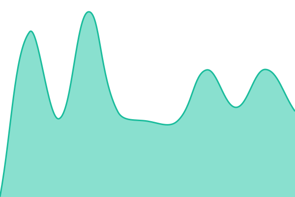
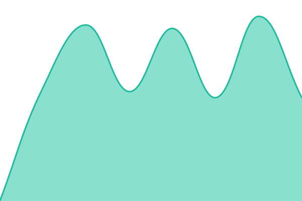

# [📈 Live Status](https://bobchomp.github.io/rtmpwebplayer-status): <!--live status--> **🟩 All systems operational**

This repository contains the open-source uptime monitor and status page for [Ross Mackenzie](https://bobchomp.github.io/rtmpwebplayer-status), powered by [Upptime](https://github.com/upptime/upptime).

With [Upptime](https://upptime.js.org), you can get your own unlimited and free uptime monitor and status page, powered entirely by a GitHub repository. We use [Issues](https://github.com/bobchomp/rtmpwebplayer-status/issues) as incident reports, [Actions](https://github.com/bobchomp/rtmpwebplayer-status/actions) as uptime monitors, and [Pages](https://bobchomp.github.io/rtmpwebplayer-status) for the status page.

<!--start: status pages-->
<!-- This summary is generated by Upptime (https://github.com/upptime/upptime) -->
<!-- Do not edit this manually, your changes will be overwritten -->
<!-- prettier-ignore -->
| URL | Status | History | Response Time | Uptime |
| --- | ------ | ------- | ------------- | ------ |
|  [Website](https://stream.rossmackenzie.co.uk/healthz) | 🟩 Up | [website.yml](https://github.com/bobchomp/rtmpwebplayer-status/commits/HEAD/history/website.yml) | 

 530ms
     
 | 

<a href="https://status.stream.rossmackenzie.co.uk/history/website">100.00%</a>
    

|  [Dashboard](https://stream.rossmackenzie.co.uk/dashboard) | 🟩 Up | [dashboard.yml](https://github.com/bobchomp/rtmpwebplayer-status/commits/HEAD/history/dashboard.yml) | 

 538ms
     
 | 

<a href="https://status.stream.rossmackenzie.co.uk/history/dashboard">100.00%</a>
    

|  [Live Streaming (RTMP Ingest)](144.126.230.185) | 🟩 Up | [live-streaming-rtmp-ingest.yml](https://github.com/bobchomp/rtmpwebplayer-status/commits/HEAD/history/live-streaming-rtmp-ingest.yml) | 

 119ms
     
 | 

<a href="https://status.stream.rossmackenzie.co.uk/history/live-streaming-rtmp-ingest">100.00%</a>
    

|  [Video Playback](https://stream.rossmackenzie.co.uk/healthz/video) | 🟩 Up | [video-playback.yml](https://github.com/bobchomp/rtmpwebplayer-status/commits/HEAD/history/video-playback.yml) | 

 448ms
     
 | 

<a href="https://status.stream.rossmackenzie.co.uk/history/video-playback">100.00%</a>
    

|  [Login](https://stream.rossmackenzie.co.uk/auth/login) | 🟩 Up | [login.yml](https://github.com/bobchomp/rtmpwebplayer-status/commits/HEAD/history/login.yml) | 

 378ms
     
 | 

<a href="https://status.stream.rossmackenzie.co.uk/history/login">100.00%</a>
    

|  [Embed Player](https://stream.rossmackenzie.co.uk/embed/468127c7-2fa6-44ef-b93a-d7d3b3aea613) | 🟩 Up | [embed-player.yml](https://github.com/bobchomp/rtmpwebplayer-status/commits/HEAD/history/embed-player.yml) | 

 439ms
     
 | 

<a href="https://status.stream.rossmackenzie.co.uk/history/embed-player">100.00%</a>
    

<!--end: status pages-->

[**Visit our status website →**](https://bobchomp.github.io/rtmpwebplayer-status)

## 📄 License

- Powered by: [Upptime](https://github.com/upptime/upptime)
- Code: [MIT](./LICENSE) © [Anand Chowdhary](https://anandchowdhary.com)
- Data in the `./history` directory: [Open Database License](https://opendatacommons.org/licenses/odbl/1-0/)
